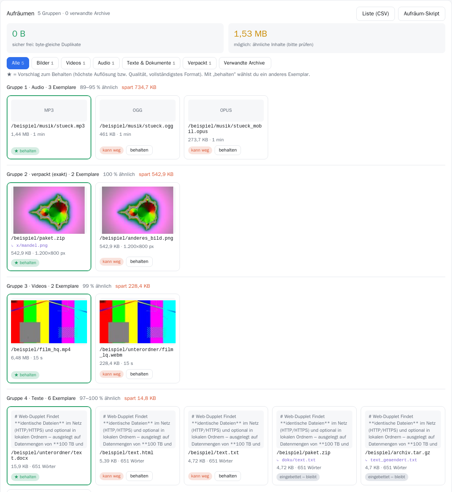

# Web-Dupplet

**Findet doppelte und ähnliche Dateien – im Netz (HTTP/HTTPS, rsync) und in lokalen Ordnern, auch bei 100 TB und mehr.**
Mit Web-Oberfläche, Behalten-Vorschlägen und einem sicheren Aufräum-Export.

> **English summary:** Web-Dupplet is a single static Go binary that finds duplicate files across web servers,
> rsync mirrors and local folders – byte-identical ones via a bandwidth-saving staged comparison (size → head/tail
> hash → full SHA-256) and, optionally, *similar* ones: resized/re-encoded images (pHash), videos and audio in other
> qualities, the same text as PDF/DOCX/HTML/TXT, images embedded in PDFs/Office files and files hidden in archives.
> It groups the results, suggests which copy to keep and exports a cleanup list or a dry-run-by-default script.
> The UI and docs are German; the code is commented in German.



## Was es kann

**Exakte Duplikate (Stufen 1–3)** – lädt nur so viel, wie zur sicheren Entscheidung nötig ist:

| Stufe | Was passiert | Traffic pro Datei |
|---|---|---|
| 1. Größe | `HEAD`-Anfrage. Einmalige Größe ⇒ **kann kein Duplikat sein**. | ~0 Byte |
| 2. Teil-Hash | Nur bei gleicher Größe: erste + letzte 64 KiB per Range-Anfrage | 128 KiB |
| 3. Voll-Hash | Nur bei gleichem Teil-Hash: komplett laden, SHA-256 | ganze Datei |

Übereinstimmung heißt immer: **identischer SHA-256 über den gesamten Inhalt**. Stufe 1 und 2 sortieren nur aus.

**Ähnliche Inhalte (Stufe 4, Option `-similar`)** – findet Dateien, die inhaltlich gleich sind, obwohl kein Byte übereinstimmt:

| Art | Erkennt | Verfahren |
|---|---|---|
| Bilder (JPG, PNG, GIF, BMP, WebP, TIFF) | andere Auflösung, anderes Format, stärkere Kompression | pHash (DCT, 64 Bit) + dHash |
| Videos (MP4, MKV, WebM, AVI, MOV, …) | neu kodiert, andere Qualität/Auflösung/Container | pHash von 8 Einzelbildern + Länge ±2 % |
| Audio (MP3, OGG, Opus, FLAC, WAV, M4A, …) | andere Bitrate, anderes Format | Spektrum in 65 Bändern, 8 Ausschnitte |
| Texte, Office, PDF | gleicher oder fast gleicher Text als TXT/HTML/RTF/DOCX/ODT/PPTX/XLSX/PDF | SimHash über Wort-Dreiergruppen |
| Bilder in PDFs und Office-Dateien | eingebettete Bilder, die es auch einzeln gibt | wie Bilder |
| Archive (ZIP, JAR, EPUB, TAR, TAR.GZ, TAR.BZ2) | Dateien, die verpackt und unverpackt vorkommen; verwandte Archive | SHA-256 je Eintrag |

**Aufräumen:** Ähnliche Dateien werden zu Gruppen zusammengefasst. Pro Gruppe schlägt Web-Dupplet ein Exemplar zum
Behalten vor (höchste Auflösung bzw. Bitrate, vollständigstes Format) – per Klick änderbar. Die mögliche Ersparnis
wird getrennt ausgewiesen: **sicher** (byte-gleich) und **ähnlich** (bitte prüfen). Export als CSV oder als Skript.

Weitere Eigenschaften:

- Eine einzige statische Datei (Linux x86_64 und ARM64), Datenbank SQLite – keine weiteren Dienste nötig.
- Fortschritt bleibt bei Neustart erhalten; nichts wird doppelt geladen.
- Webseiten und Dateilisten (z. B. `IndexByDate.txt`) durchsuchen, `rsync://`-Quellen, lokale Ordner.
- Höflich zu Servern: Verbindungen pro Server begrenzt, `robots.txt` wird beachtet, Wiederholung mit Wartezeit.
- Dateityp wird auch am Inhalt erkannt (Dateien ohne Endung).
- Gesamte Download-Rate begrenzbar (`-max-rate`), eigener Worker-Pool für Video/Audio.

## Schnellstart

Fertiges Paket von der [Releases-Seite](../../releases) laden oder selbst bauen (Go ≥ 1.26):

```bash
./paket.sh                     # baut dist/web-dupplet.tar.gz (x86_64 + ARM64)
# oder nur für diesen Rechner:
CGO_ENABLED=0 go build -o web-dupplet .
```

Direkt starten:

```bash
./web-dupplet -urls meine-urls.txt                 # eine URL pro Zeile
./web-dupplet -crawl https://example.org/dateien/  # Webseite nach Dateien durchsuchen
./web-dupplet -scan /mnt/archiv -similar           # lokaler Ordner, mit Ähnlichkeitsanalyse
# Browser: http://127.0.0.1:8080
```

Weitere URLs, Webseiten und Ordner lassen sich jederzeit in der Web-Oberfläche hinzufügen.
Strg+C beendet sauber; beim nächsten Start geht es genau dort weiter (alles steht in `dupplet.db`).

### Als Dienst installieren (systemd)

```bash
tar xzf web-dupplet.tar.gz && cd web-dupplet
sudo ./install.sh              # Port 8080; anderer Port: sudo PORT=9000 ./install.sh
```

`install.sh` legt einen eigenen Benutzer ohne Login an, richtet einen systemd-Dienst ein (Neustart nach Absturz,
CPU-Begrenzung, niedrige Priorität), installiert bei Bedarf `rsync`, `ffmpeg` und `poppler-utils` und erzeugt ein
zufälliges Passwort. Einstellungen stehen in `/etc/web-dupplet.env`; ein erneutes `install.sh` (Update) behält Daten,
Passwort und Einstellungen. Lauscht die Web-UI nur auf `127.0.0.1`, wird kein Firewall-Port geöffnet – Zugriff dann
z. B. per SSH-Tunnel: `ssh -L 8080:127.0.0.1:8080 server`. Mehr in [`deploy/ANLEITUNG.txt`](deploy/ANLEITUNG.txt).

> **Sicherheit:** Die Web-UI nutzt HTTP Basic Auth ohne eigenes TLS. Nicht ungeschützt ins Internet stellen –
> nur lokal/im LAN, per SSH-Tunnel oder hinter einem Reverse-Proxy mit HTTPS.

## Aufräumen

In der Web-UI unter **Aufräumen**:

- **Liste (CSV)** – alle Gruppen mit `behalten` / `löschen` / `bleibt (eingebettet)`, getrennt nach
  *sicher (byte-gleich)* und *prüfen (ähnlich)*.
- **Aufräum-Skript** – Bash-Skript nur für **lokale** Dateien:
  - es **verschiebt** in einen Ordner (`ZIEL`, Standard `./aussortiert`) – es löscht nichts,
  - ohne `AUSFUEHREN=1` ist es ein **Probelauf**,
  - byte-gleiche Duplikate sind aktiv, ähnliche Inhalte **auskommentiert** (erst prüfen, dann einkommentieren),
  - jede Zeile prüft vorher, ob die Datei noch existiert und dieselbe Größe hat.

```bash
bash aufraeumen.sh                      # Probelauf: zeigt, was passieren würde
AUSFUEHREN=1 bash aufraeumen.sh         # verschiebt nach ./aussortiert
```

Dateien im Netz kann Web-Dupplet naturgemäß nicht löschen – für sie ist die CSV-Liste gedacht.

## Optionen

| Option | Standard | Bedeutung |
|---|---|---|
| `-urls DATEI` | – | URL-Liste (eine pro Zeile, `#` = Kommentar, `-` = stdin). Mehrfach möglich. |
| `-crawl URL` | – | Webseite oder Dateiliste nach Dateien durchsuchen |
| `-ext` | `*` | Dateitypen für `-crawl`: `*`, `word`, `bilder`, `videos`, `audio`, `office`, `archive` oder Endungen wie `pdf,docx` |
| `-scan ORDNER` | – | Lokalen Ordner rekursiv mit vergleichen. Mehrfach möglich. |
| `-db DATEI` | `dupplet.db` | Datenbank mit dem gesamten Fortschritt |
| `-listen ADR` | `127.0.0.1:8080` | Adresse der Web-UI |
| `-auth user:pw` | – | Passwortschutz der Web-UI (dringend empfohlen außerhalb von `127.0.0.1`) |
| `-store ORDNER` | – | Downloads behalten, abgelegt als `objects/ab/cd/<sha256>` (Duplikate nur 1×) |
| `-full` | aus | Jede Datei komplett hashen (keine Abkürzungen) |
| `-probe-workers` | 64 | Parallele Größenabfragen |
| `-fetch-workers` | 128 | Parallele Downloads |
| `-local-workers` | 4 | Parallele lokale Leser (HDD: 1–2, NVMe: 8–16) |
| `-per-host` | 16 | Max. Download-Verbindungen pro Server |
| `-probe-per-host` | 16 | Max. gleichzeitige Größenabfragen pro Server |
| `-max-rate` | 0 | Gesamte Download-Rate in MB/s (0 = unbegrenzt) |
| `-timeout` | 60s | Abbruch, wenn so lange keine Daten kommen |
| `-retries` | 3 | Versuche bei vorübergehenden Fehlern |
| `-user-agent` | `Web-Dupplet/1.0` | HTTP User-Agent (gern mit Kontaktadresse, manche Server verlangen das) |
| `-similar` | aus | Stufe 4: ähnliche Inhalte finden |
| `-analyze-workers` | 4 | Parallele Ähnlichkeitsanalysen (Bilder, Texte, PDFs, Archive) |
| `-media-workers` | 2 | Parallele Analysen für Video und Audio (eigener Pool) |
| `-sim-max` | 512 | Größere Dateien (MB) nicht für die Ähnlichkeit laden (Video/Audio ausgenommen) |
| `-video-frames` | 8 | Einzelbilder bzw. Audio-Ausschnitte pro Datei |

Für die Ähnlichkeitsanalyse werden `ffmpeg` (Video, Audio) und `poppler-utils` (PDF) benötigt. Fehlen sie, werden
diese Typen übersprungen und die Web-UI weist darauf hin.

## Wie die Ähnlichkeitsanalyse arbeitet

- Jede Datei wird höchstens einmal analysiert. **Byte-gleiche Kopien** einer schon analysierten Datei werden
  übersprungen – ihr Fingerabdruck wäre identisch. Die Analyse wartet dafür, bis Stufe 2/3 über gleich große
  Dateien entschieden hat.
- Bilder, Dokumente und Archive werden komplett geladen (bis `-sim-max`). **Videos und Audio nicht:** ffmpeg springt
  per Range-Anfrage zu den Ausschnitten (parallel). Kann ein Server keine Range-Anfragen, wird die Datei komplett
  geladen, sonst lieferte ffmpeg stillschweigend falsche Bilder.
- Neue Fingerabdrücke werden sofort mit allen bisherigen verglichen. Die Suche nutzt **Multi-Index-Hashing**: Bei
  höchstens 7 abweichenden Bits stimmt garantiert eins der 8 Bytes überein, also werden nur ≈ 8/256 aller Einträge geprüft.
- **Schwellen** (Hamming-Abstand von 64 Bit): Bilder ≤ 8 (pHash) und ≤ 14 (dHash), Texte ≤ 7, Videos/Audio ≥ 75 % der
  Ausschnitte ≤ 10 bzw. ≤ 12. Zufällig verschiedene Inhalte liegen bei etwa 32.
- **Schutz vor Fehltreffern:** einfarbige Bilder und sehr kurze Texte bekommen keinen Fingerabdruck; eingescannte
  Schwarz-Weiß-Seiten in PDFs werden nicht als Bild verglichen (sie sähen sich verkleinert alle ähnlich);
  Fingerabdrücke mit über 100 Treffern gelten als „zu allgemein“.
- **Archive:** jede enthaltene Datei ab 4 KiB bekommt einen SHA-256. Liegt sie auch einzeln vor, entsteht eine
  Gruppe „verpackt“. Zwei Archive mit gemeinsamen Dateien ergeben eine Zeile „verwandte Archive“.
- **Vorübergehende Fehler** (429, 5xx, Zeitüberschreitung, Netz) werden nach 5 min, 30 min und 3 h wiederholt.

**Grenzen:** Erkannt wird dasselbe Motiv bzw. derselbe Inhalt – nicht „ähnliche Motive“ (zwei verschiedene Fotos
desselben Hauses), keine gespiegelten oder stark beschnittenen Bilder, keine Videos mit anderem Schnitt.

## Web-API

| Aufruf | Inhalt |
|---|---|
| `GET /api/stats` | alle Zahlen als JSON (Ähnlichkeit unter `sim`) |
| `GET /api/groups?offset=&limit=` | byte-gleiche Duplikatgruppen, nach verschwendetem Platz |
| `GET /api/export.csv` | alle byte-gleichen Duplikate |
| `GET /api/clusters?kind=&offset=&limit=` | Gruppen ähnlicher Inhalte (1 Bild, 2 Text, 3 Video, 4 verpackt, 5 Audio) |
| `POST /api/keep` | `{"file":ID,"sub":""}` – dieses Exemplar behalten |
| `GET /api/arcrels` | verwandte Archive |
| `GET /api/cleanup.csv`, `GET /api/cleanup.sh` | Aufräum-Liste bzw. -Skript |
| `GET /api/similar?kind=&offset=&limit=`, `GET /api/similar.csv` | einzelne ähnliche Paare |
| `POST /api/add` | URLs als Text (eine pro Zeile) |
| `POST /api/crawl` | `{"url":"…","exts":"*"}` |
| `POST /api/scan` | `{"path":"/mnt/x"}` |
| `POST /api/pause?on=1` / `?on=0` | anhalten / fortsetzen |
| `POST /api/similar/retry` | fehlgeschlagene Analysen erneut versuchen |

## Verantwortungsvoller Einsatz

Web-Dupplet kann große Datenmengen in kurzer Zeit abfragen. Bitte nur Server durchsuchen, bei denen das erlaubt ist
(öffentliche Mirrors, eigene Server), die Verbindungen pro Server niedrig halten (`-per-host`, `-probe-per-host`)
und im `-user-agent` eine Kontaktmöglichkeit angeben. Für fremde, kleine Server: lieber `-per-host 2–4`.

## Entwicklung

```bash
go vet ./...
go test ./...          # Video-/Audio-Tests brauchen ffmpeg, PDF-Teile poppler-utils
go test -race ./...
```

Aufbau: `engine.go` (Stufen 1–3, Warteschlange), `fetch.go` (Downloads, Hashes, Ratenbegrenzung), `crawl.go` /
`rsync.go` (Quellen), `similar.go` (Stufe 4), `fingerprint.go` / `audio.go` / `extract.go` / `sniff.go`
(Fingerabdrücke und Inhalte), `groups.go` (Gruppen, Behalten-Vorschlag, Export), `web.go` / `web_similar.go` + `ui/` (Oberfläche).

## Lizenz

[MIT](LICENSE). Verwendete Bibliotheken: [modernc.org/sqlite](https://gitlab.com/cznic/sqlite) (BSD-3-Clause),
[golang.org/x/image](https://pkg.go.dev/golang.org/x/image) (BSD-3-Clause). Zur Laufzeit optional:
ffmpeg (LGPL/GPL) und poppler-utils (GPL) als eigenständige Programme.
